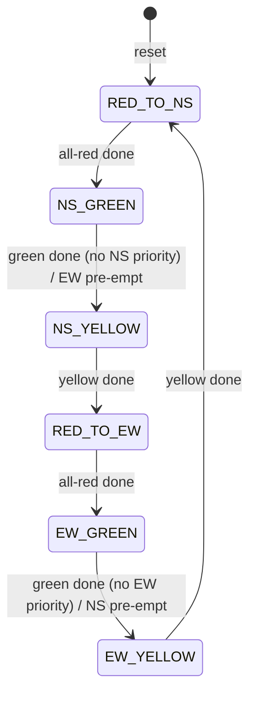

# FSM-Based Traffic Signal Controller (Verilog HDL)

A Moore finite state machine that controls a **4-way traffic intersection**
with timed Red / Yellow / Green transitions, emergency-priority logic and a
synchronous reset. Written in synthesizable Verilog-2001 and verified with a
self-checking testbench.

## Features
- 6-state Moore FSM (North/South phase and East/West phase)
- Timed Green → Yellow → All-Red sequencing (all durations are parameters)
- **Priority logic**: `emg_ns` / `emg_ew` hold or pre-empt the green phase
  (pre-emption always passes through Yellow and All-Red)
- **Reset**: synchronous, active-high, forces the safe all-red state
- Illegal-state recovery (`default` branch returns to all-red)
- Self-checking testbench with a continuous safety monitor
  (conflicting greens are flagged as errors)

## State diagram


## Ports
| Port | Dir | Description |
|------|-----|-------------|
| `clk` | in | System clock |
| `rst` | in | Synchronous active-high reset |
| `emg_ns` | in | Priority request for North/South |
| `emg_ew` | in | Priority request for East/West |
| `n_light`, `s_light`, `e_light`, `w_light` | out [2:0] | `{RED, YELLOW, GREEN}` one-hot per direction |

## Parameters
| Parameter | Default | Meaning |
|-----------|---------|---------|
| `CLKS_PER_TICK` | 1 | Clock cycles per time tick (set = clock Hz for 1 s ticks) |
| `GREEN_TICKS` | 10 | Green duration |
| `YELLOW_TICKS` | 3 | Yellow duration |
| `ALL_RED_TICKS` | 1 | All-red clearance duration |
| `MIN_GREEN_TICKS` | 4 | Minimum green before an emergency pre-empt is allowed |

## Priority behaviour
| `emg_ns` | `emg_ew` | Behaviour |
|:-:|:-:|---|
| 0 | 0 | Normal timed cycle |
| 1 | 0 | NS green is held; EW green is pre-empted after `MIN_GREEN_TICKS` |
| 0 | 1 | EW green is held; NS green is pre-empted after `MIN_GREEN_TICKS` |
| 1 | 1 | Conflict → normal timed cycle |

## Repository structure
```
.
├── rtl/traffic_signal_controller.v      # design
├── tb/tb_traffic_signal_controller.v    # self-checking testbench
├── Makefile
├── LICENSE
└── README.md
```

## How to run
Requires [Icarus Verilog](https://steveicarus.github.io/iverilog/) and
(optionally) GTKWave.

```bash
make sim     # compile + run, prints [ OK ] / [FAIL] lines and a final RESULT
make wave    # open sim/traffic.vcd in GTKWave
make clean
```

Vivado: add `rtl/traffic_signal_controller.v` as a design source and
`tb/tb_traffic_signal_controller.v` as a simulation source
(create the `sim/` folder or edit the `$dumpfile` path in the testbench).

## Tools
Verilog HDL · Icarus Verilog · GTKWave · Xilinx Vivado

## Author
**Muhammad Sahil** — M.Tech (Signal Processing & ML), NIT Jalandhar
